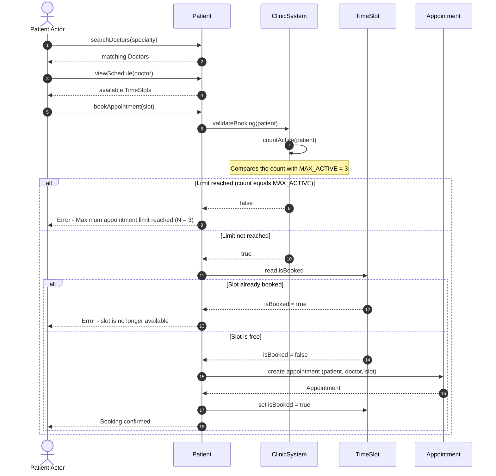

# Sequence Diagram: Book Appointment

This diagram models Use Case 1 (Book Appointment) from `2_use_cases.md`. It uses the classes, methods and
attributes of the class diagram (`User`, `Patient`, `Doctor`, `ClinicSystem`, `TimeSlot`, `Appointment`) and
the business rule `MAX_ACTIVE = 3` (requirement R4).

## How the diagram maps to the other deliverables

| Diagram element | Source |
|---|---|
| Steps 1-5 (search, view schedule, book) | `Patient.searchDoctors`, `viewSchedule`, `bookAppointment` in the class diagram; Use Case 1, steps 1-2 |
| `validateBooking` / `countActive` | `ClinicSystem` in the class diagram; Use Case 1, step 3; requirement R4 |
| Limit-reached branch | Use Case 1, alternative flow (Limit Exceeded) |
| `isBooked` check, then `isBooked = true` | `TimeSlot.isBooked`; Use Case 1, step 4 ("updates slot status") |
| `Appointment` creation | `Patient` "books" `Appointment` (1 to 0..*) in the class diagram |
